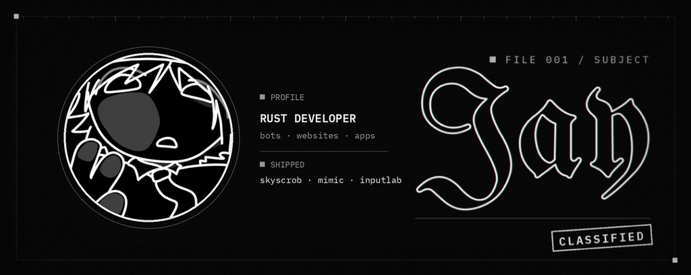

  

  
  

**■ FILE 001 / SUBJECT**

Rust developer. I build bots, websites and apps, mostly because I wanted them to exist, and I ship them.

### ■ CASE FILES

| case | what it is | built with | status |
| --- | --- | --- | --- |
| [skyscrob](https://github.com/ag0nyy-ops/skyscrob) | Scrobbles Apple Music to Last.fm from any device. Runs on Cloudflare, nothing to keep open. | TypeScript, Cloudflare Workers |  |
| [inputlab](https://github.com/ag0nyy-ops/inputlab) | Native input tester for keyboards, mice, controllers and HID gear. Real polling rate and DPI, no network. | Tauri, TypeScript |  |
| [Mimic](https://github.com/ag0nyy-ops/Mimic) | Put any game on your Discord rich presence. Searchable picker, presets, tray app. | Rust, Tauri |  |
| [revived](https://github.com/ag0nyy-ops/revived) | From-scratch rewrites of abandoned open-source tools, with tests. | Go, Rust |  |
| [name](https://github.com/ag0nyy-ops/name) | Name rarity calculator on SSA and Census data. Runs entirely in your browser. | Next.js, TypeScript, Tailwind |  |
| [ag0nyy-ops.github.io](https://github.com/ag0nyy-ops/ag0nyy-ops.github.io) | My portfolio. No framework, CSS-heavy, three performance tiers. | HTML, CSS, JavaScript |  |
<!-- TODO: add NutritionCoach (Swift, SwiftUI, HealthKit) once the repo is public -->

### ■ TOOLS

  
  
  
  
  
  
  
  
  
  
  
  

